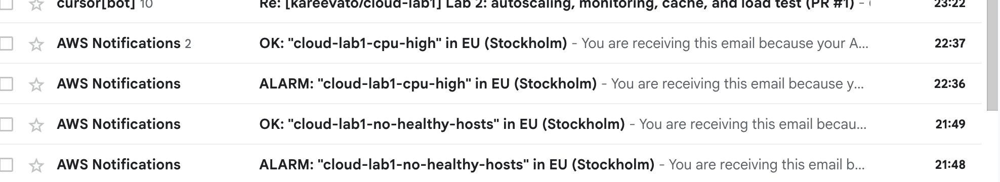

Email-алерти:

Алерт налаштований у Terraform, у файлі terraform/alerts.tf. Канал доставки це SNS-тема cloud-lab1-alerts з email-підпискою. Адреса пошти не зберігається в репозиторії, вона в terraform.tfvars. Підписку треба підтвердити посиланням з листа AWS.

Умова спрацювання:

CloudWatch-тривога cloud-lab1-cpu-high: середнє завантаження CPU групи вище 70% протягом двох хвилин поспіль. Коли значення повертається нижче 70%, тривога переходить у стан OK і надсилається другий лист.

Чому саме така умова:

Автоскейлінг починає додавати екземпляри при 50%. Якщо CPU все одно доходить до 70% і тримається дві хвилини, сервіс не встигає за навантаженням. Дві хвилини потрібні, щоб короткий одноразовий сплеск не надсилав лист.

Листи під час тесту:

Пара листів це ALARM о 22:36 і OK о 22:37 за Києвом. У пошті є ще один OK на `cloud-lab1-cpu-high` о 21:44. Він прийшов раніше за ці дві хвилини вище порога, тож у звіт входить пара 22:36 і 22:37.

ALARM, стан OK → ALARM, час у листі Tuesday 03 November 2026 20:36:44 UTC (22:36:44 за Києвом). Причина: дві точки поспіль вищі за 70,0. Хвилина з 20:30 UTC (22:30 за Києвом) дала 70,475%. Хвилина з 20:35 UTC (22:35 за Києвом) дала 74,304%.

OK, стан ALARM → OK, час у листі 20:37:44 UTC (22:37:44 за Києвом). Причина: точка за ту саму хвилину 20:35 UTC після уточнення стала 66,994% і вже не вища за 70,0. Тривога протрималась одну хвилину.

Час реакції:

Умова чекає дві хвилини по 60 секунд. Друга хвилина закрилась о 22:36:00 за Києвом, лист ALARM прийшов о 22:36:44. Оцінка метрики в CloudWatch і доставка SNS зайняли 44 секунди. Від початку першої хвилини вище порога (22:30:00) до листа минуло 6 хвилин 44 секунди: самі дві хвилини умови і час, поки середнє CPU лишалось вище 70%.
