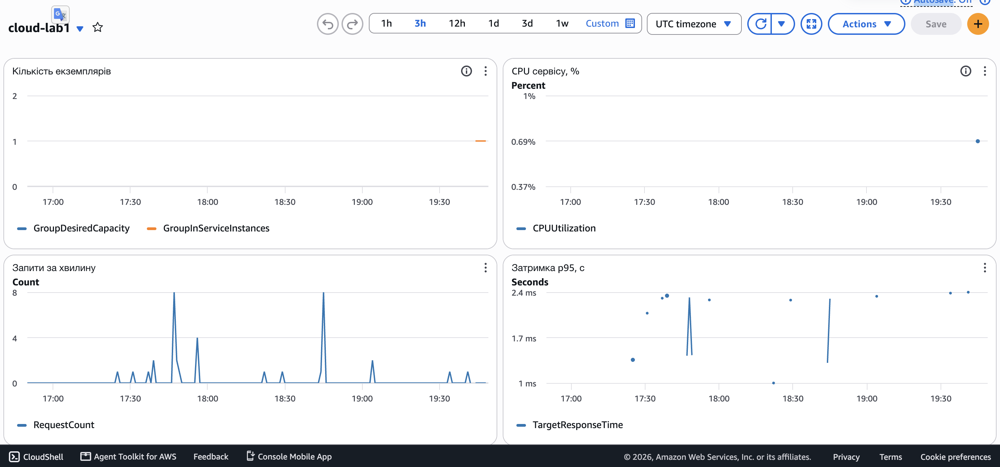
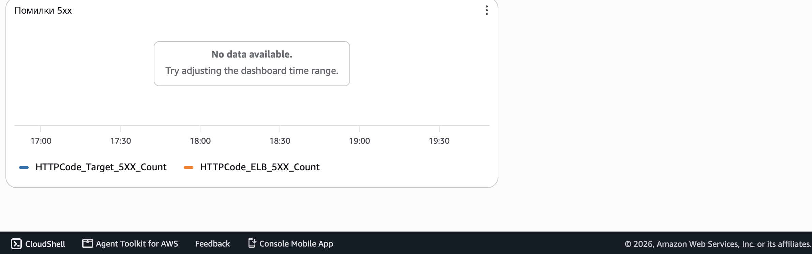
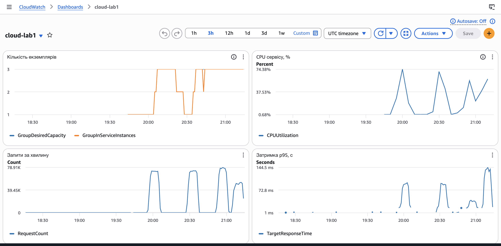
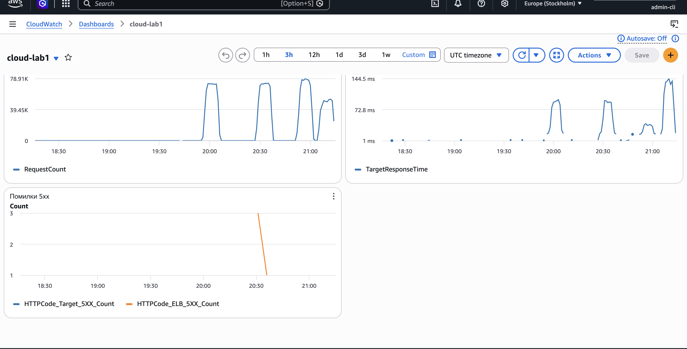

Автоматичне масштабування:

Масштабування налаштоване в Terraform, у файлі terraform/autoscaling.tf. Воно працює для групи cloud-lab1-asg.

Параметри:

Мінімальна кількість екземплярів: 1.
Максимальна кількість екземплярів: 3.
Метрика: середнє завантаження процесора по групі.
Цільове значення: 50 відсотків.
Пауза після зміни розміру групи: 120 секунд.
Прогрів нового екземпляра: 60 секунд.

Чому саме такі значення:

Мінімум 1, бо сервіс має працювати завжди, а кожен додатковий екземпляр коштує грошей. Для звичайного навантаження одного екземпляра достатньо.

Максимум 3, бо за умовою лабораторної можна не більше 4 екземплярів. Три дають достатній запас, і витрати під час тесту лишаються невеликими.

Метрика процесор, бо під навантаженням її просто виміряти на групі EC2.

Цільове значення 50 відсотків вибране з запасом. Новий екземпляр запускається не одразу. Якщо поставити 80 або 90 відсотків, перший екземпляр встигне перевантажитись до того, як з'явиться другий. При 50 відсотках масштабування починається раніше.

Що таке cooldown:

Cooldown це пауза після масштабування. Поки вона триває, система не виконує наступну дію в той самий бік. Це потрібно, бо новому екземпляру треба час, щоб запуститись і почати приймати запити, а до цього середнє завантаження ще показує старе високе значення. Без паузи система могла б додати зайві екземпляри.

Прогрів 60 секунд, щоб реагувати швидко. Пауза групи 120 секунд, щоб не прибирати екземпляри через короткий спад навантаження.

Що буде, якщо cooldown дорівнює нулю:

Система реагує на кожну зміну метрики без пауз. Завантаження піднялось, екземпляр додали. Воно трохи впало, екземпляр прибрали. Потім воно знову піднялось, і екземпляр знову додають. Екземпляри постійно запускаються і зупиняються, сервіс працює нестабільно, а ми платимо за зайві запуски.

Панель після запуску групи:

Знімок дашборда `cloud-lab1` за 3 години, час на осі в UTC (за Києвом на дві години більше). Бажана кількість екземплярів увесь час 1. Фактично в групі екземпляр з'явився близько 19:30 UTC, тобто близько 21:30 за Києвом. CPU близько 0,7%. Запитів за хвилину одиниці, з короткими піками до 8. Затримка p95 близько 1–2,4 мс. Помилок 5xx за цей проміжок немає.

Це знімок до k6. Навантаження мале, CPU близько 0,7%, поріг 50% ще не перетнуто.

Панель під час тестів:

Той самий дашборд, вікно 3 години, вісь UTC. На графіку запитів чотири піки. Верх шкали це найбільше значення у вікні: CPU 74,38%, запити 78,91 тис. за хвилину, p95 затримки балансувальника 144,5 мс.

1. Близько 20:00 UTC (22:00 за Києвом). Перший прогін на старому образі. Запити біля верхньої межі шкали. CPU доходить до 74,38%, вище цілі 50% і порога листа 70%. Кількість екземплярів у групі зростає з 1 до 3.
2. Близько 20:30 UTC (22:30 за Києвом). Другий прогін, теж старий образ: читання ще не проходили. CPU знову високий, запити знову біля верху шкали. Ближче до 20:35 UTC кількість екземплярів у сервісі коротко падає до 1 і повертається до 3. Це заміна екземплярів під час деплою.
3. Близько 20:50–21:00 UTC (22:50–23:00 за Києвом). Успішний прогін з кешем: 1008,89 запитів за секунду, p95 у k6 69,89 мс. Група вже на максимумі 3, нових екземплярів немає. Пік затримки на балансувальнику нижчий за перші два, CPU теж нижче перших піків.
4. Одразу після 21:00 UTC (після 23:00 за Києвом). Прогін без кешу: 710,94 запитів за секунду, p95 у k6 159,72 мс. Пік запитів нижчий за три попередні. Пік затримки найвищий на графіку: шкала p95 доходить до 144,5 мс. k6 міряє з ноутбука і дає 159,72 мс за весь прогін. CPU знову росте. Група лишається на 3, бо це максимум.

Помилки 5xx від застосунку (`HTTPCode_Target_5XX_Count`) за все вікно нульові. Єдиний сплеск це 5xx балансувальника (`HTTPCode_ELB_5XX_Count`): 3, потім 1, близько 20:35 UTC, коли в групі на мить не було здорової цілі. Під час двох успішних прогонів цього сплеску немає.

Чому новий екземпляр з'являється із запізненням:

1. CloudWatch отримує метрику CPU раз на хвилину.
2. Політика за ціллю чекає кілька точок поспіль, щоб короткий сплеск не запускав нові екземпляри.
3. Після рішення EC2 має виконати user_data, завантажити образ і пройти перевірку здоров'я. Лише тоді балансувальник надсилає на нього трафік.

Чому видалення значно пізніше за спад навантаження:

Політика зменшує кількість екземплярів обережніше, ніж збільшує. Додати екземпляр дорого за часом, а прибрати його швидко, і помилка в цей бік одразу відчувається користувачами. Тому CPU має потриматись нижче цілі, і додатково діє пауза 120 секунд.
